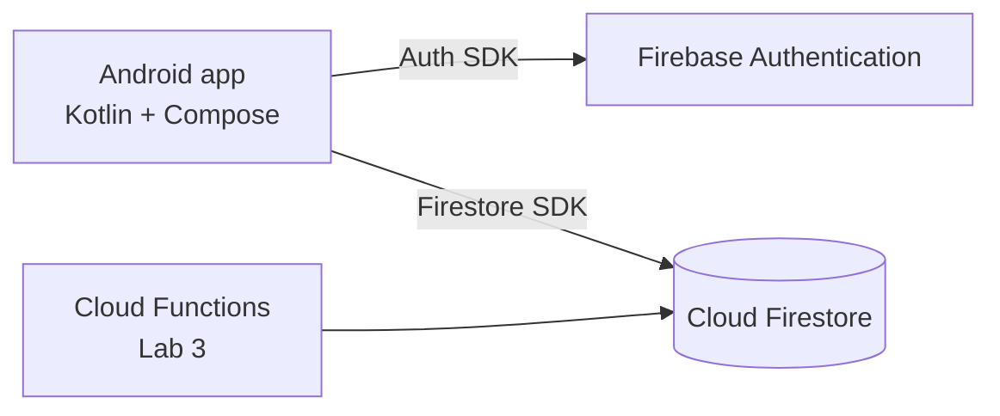

# DeadlineTracker

Students lose track of deadlines spread across many courses, and DeadlineTracker gives them one clear, always-available overview.

## Team
Solo team: Yevhenii Lebediev (58798), who holds all roles (Product Owner, Tech Lead, Developer, QA/DevOps).

## MVP features
Sprint 1:
- Register and log in with email and password
- Add a deadline
- List deadlines sorted by due date
- Edit and delete a deadline
- Mark a deadline as done

Later: filter by course, reminders, file attachments.

## Data model (Cloud Firestore)

| Collection | Fields (type) |
|---|---|
| users | uid (doc id), email (string), displayName (string), createdAt (timestamp) |
| courses | ownerId (string), name (string), code (string), createdAt (timestamp) |
| deadlines | ownerId (string), courseId (string), title (string), dueDate (timestamp), priority (string), isDone (boolean), createdAt (timestamp) |

`ownerId` links a document to the user who owns it.

## Architecture

## How to run
1. Clone the repository and open it in Android Studio.
2. Wait for the Gradle sync.
3. Run the app on an emulator or phone. `google-services.json` is already in `app/`.